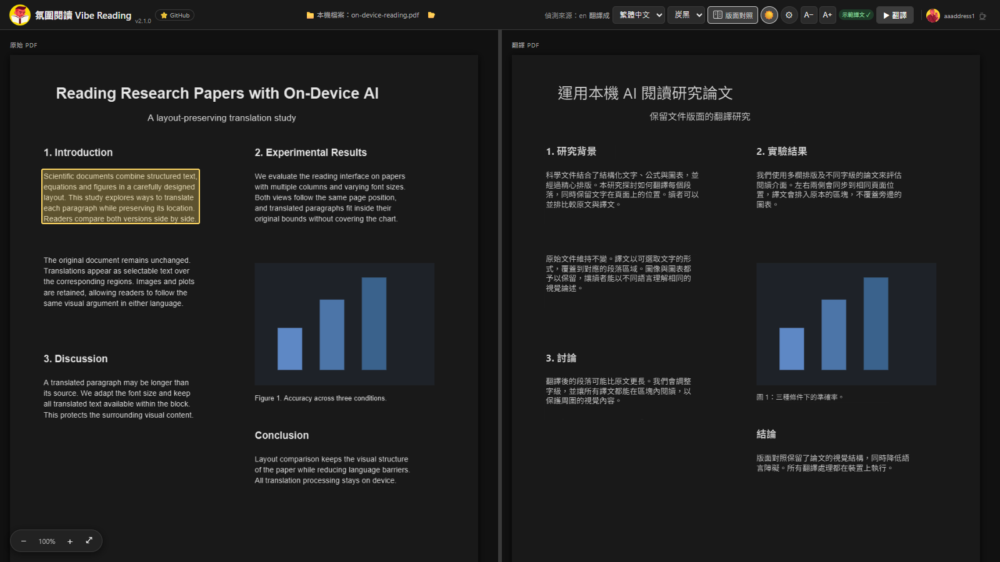
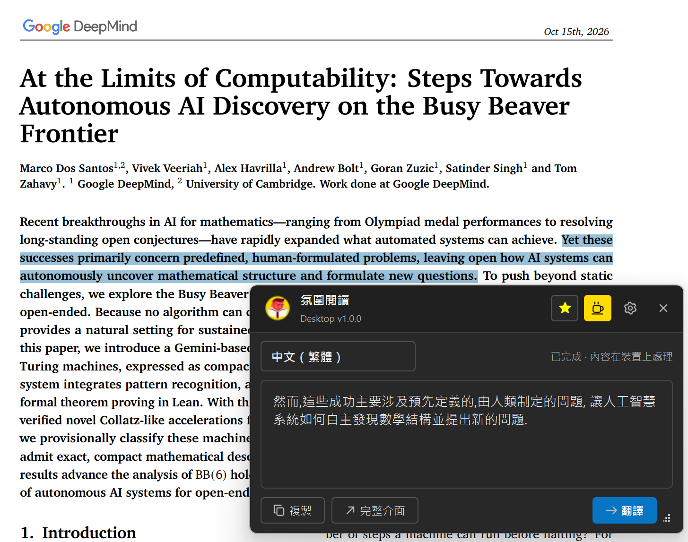
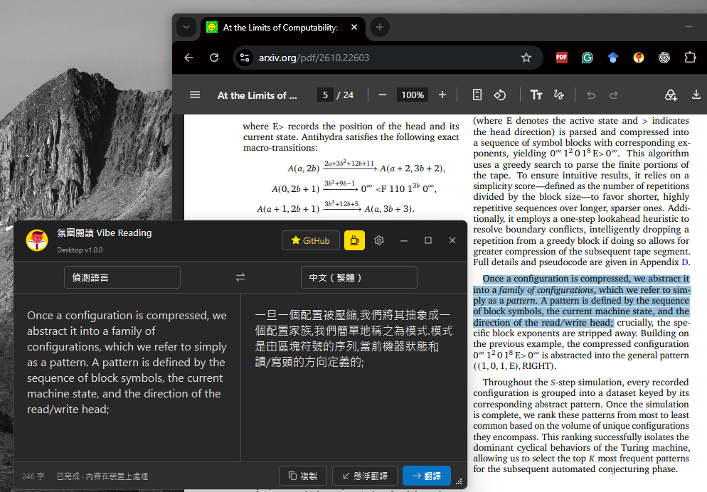

#  Vibe Reading

**Read papers, translate web pages, and translate selected text in other apps.** Content stays on your device. Translation works offline after downloading the models.

[繁體中文](README.md) · **English**

[Chrome Web Store](https://chromewebstore.google.com/detail/氛圍閱讀-vibe-reading/aaiiajcclefdjeegondambmholpnkjme) · [Edge Add-ons](https://microsoftedge.microsoft.com/addons/detail/氛圍閱讀-vibe-reading/dapinmajdflnihlikbpdjiaaodcefekl) · [Windows desktop download](https://github.com/aaaddress1/vibe-reading/releases/tag/desktop-v1.0.0)

## Browser extension

- **PDF comparison:** read the original and translation side by side, with figures preserved. Click a translation to locate its source.
- **Bilingual web pages:** click the floating ball, translate selected text, or hold Shift and hover over a paragraph.
- **Summaries and questions:** summarize papers and ask about selections. Requires supported built-in browser AI.

Install from a store, then open a PDF and click the extension icon or press **Alt+T**. Open local PDFs with 📂 or drag and drop. Use ⚙ for language, model, and theme settings.

*This extension preview uses a sample document and preset translations. PDFs need extractable text; scanned-document OCR is not supported. Edge for Android is supported; Chrome for Android and iOS are not.*

## Windows desktop v1.0

**Select text and quickly press Ctrl+C twice to translate.** Works in readers, browsers, and other apps that allow text copying.

- **Popup or two columns:** choose in ⚙. The shortcut brings your chosen interface forward.
- **Automatic model loading:** the selected model loads at startup and after switching. Requests made while loading continue automatically when ready.
- **Dedicated multilingual translation:** NLLB 1.3B prioritizes quality; 600M balances speed and quality. Both cover about 200 languages/scripts. Lightweight Chinese–English Opus-MT is also available.
- **Paste and translate:** Ctrl+Enter translates in the full window; Esc hides it. The app stays in the system tray.

Download the Windows **[.msi installer](https://github.com/aaaddress1/vibe-reading/releases/download/desktop-v1.0.0/vibe-reading-desktop-v1.0.0-windows-x64.msi)**, double-click to install, then launch from your desktop or Start menu. Models require an initial internet download.

NLLB weights are licensed for non-commercial use. See [third-party licenses](desktop/THIRD_PARTY.md).

### Same-text speed test

The same [1,500-character English passage](desktop/benchmarks/comparison-en-1500.txt), translated into Traditional Chinese, **with the local model already loaded and warmed up**. Median time to the complete result over three runs:

| Translator | Time |
| --- | ---: |
| DeepL website | 3.12 s |
| Desktop NLLB 1.3B | 19.33 s |

DeepL was faster in this test. Desktop translation works offline and keeps content on your device. Model loading took about 4.6 s separately. Tested 2026-10-28 on Core Ultra 7 258V; local INT8, 4 threads, beam 4, batch 2, excluding download, model loading and app cache. DeepL includes network and browser interaction; server caching is unknown. [Test records](desktop/benchmarks/RESULTS.md)

---

[Report an issue](https://github.com/aaaddress1/vibe-reading/issues) · [Contributors](https://github.com/aaaddress1/vibe-reading/graphs/contributors) · [Buy the author a coffee](https://buymeacoffee.com/aaaddress1) · [MIT License](LICENSE)
