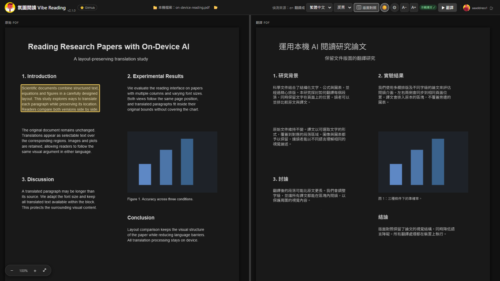
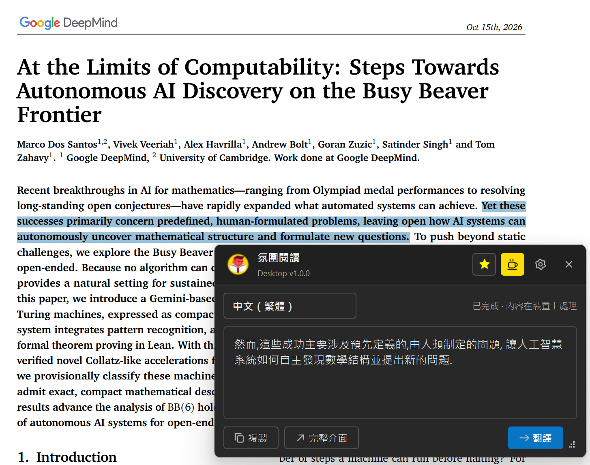
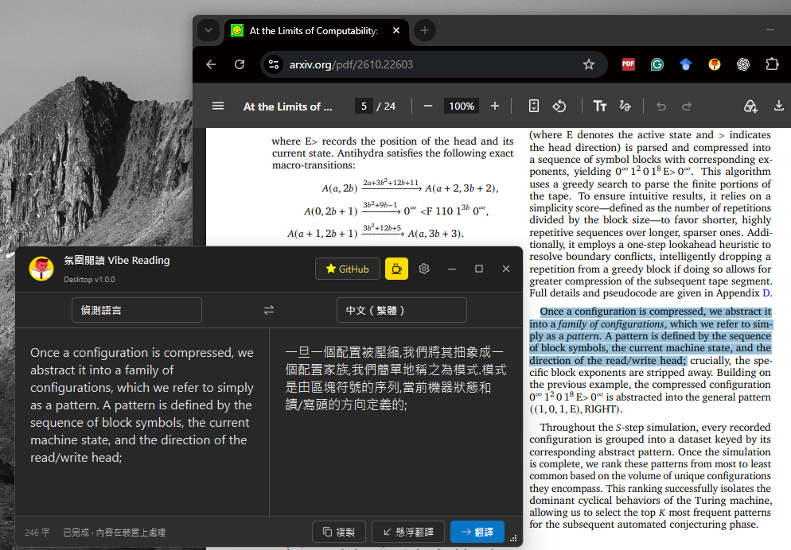

#  氛圍閱讀 · Vibe Reading

**讀論文、翻網頁，也翻譯任何程式中選取的文字。** 內容在自己的裝置上處理，模型下載後可離線翻譯。

**繁體中文** · [English](README.en.md)

[Chrome 商城](https://chromewebstore.google.com/detail/氛圍閱讀-vibe-reading/aaiiajcclefdjeegondambmholpnkjme) · [Edge 商城](https://microsoftedge.microsoft.com/addons/detail/氛圍閱讀-vibe-reading/dapinmajdflnihlikbpdjiaaodcefekl) · [Windows 桌面版下載](https://github.com/aaaddress1/vibe-reading/releases/tag/desktop-v1.0.0)

## 瀏覽器插件

- **PDF 對照閱讀**：原文與譯文並排，保留圖表；點譯文定位原文。
- **網頁雙語**：點右下角翻譯球；也可選取文字翻譯，或按住 Shift 懸停翻譯。
- **摘要與問答**：整理論文重點、針對選取內容提問，需瀏覽器內建 AI 支援。

從商城安裝後，開啟 PDF 點插件圖示或按 **Alt+T**；本機 PDF 用 📂 選檔或拖入。語言、模型與配色在 ⚙ 調整。

*此插件預覽使用示範文件與預置譯文。PDF 需含可擷取文字，暫不支援掃描 OCR。Edge Android 可用；Android Chrome／iOS 不支援。*

## Windows 桌面版 v1.0

**選取文字，快速按兩次 Ctrl+C，即可翻譯。** 閱讀器、瀏覽器或其他可複製文字的程式都能使用。

- **懸浮框／雙欄二選一**：可在 ⚙ 切換；快捷鍵會主動叫出所選介面。
- **啟動自動掛載模型**：載入中送出的翻譯會接續執行；切換模型也會背景載入。
- **多語純翻譯模型**：NLLB 1.3B 品質優先、600M 多語均衡，約 200 種語言／文字；另有輕量中英 Opus-MT。
- **貼上也能翻**：雙欄中按 Ctrl+Enter 翻譯、Esc 收起；程式會留在系統匣。

下載 Windows **[.msi 安裝程式](https://github.com/aaaddress1/vibe-reading/releases/download/desktop-v1.0.0/vibe-reading-desktop-v1.0.0-windows-x64.msi)**，雙擊安裝後從桌面或開始功能表開啟。首次使用模型需連網下載。

NLLB 模型為非商用授權；詳見[第三方授權](desktop/THIRD_PARTY.md)。

### 同文速度實測

同一段 [1,500 字元英文](desktop/benchmarks/comparison-en-1500.txt)翻成繁中；**本機模型已載入並暖機**，三次完整譯文耗時的中位數：

| 翻譯方式 | 耗時 |
| --- | ---: |
| DeepL 網頁版 | 3.12 秒 |
| 桌面版 NLLB 1.3B | 19.33 秒 |

本次 DeepL 較快；桌面版可離線、內容不送雲端。模型掛載另計約 4.6 秒。2026-10-28，Core Ultra 7 258V；本機 INT8、4 執行緒、beam 4、批次 2，排除下載／載入／應用程式快取。DeepL 含網路及頁面操作時間，服務端快取未知。[測試紀錄](desktop/benchmarks/RESULTS.md)

---

[回報問題](https://github.com/aaaddress1/vibe-reading/issues) · [貢獻者](https://github.com/aaaddress1/vibe-reading/graphs/contributors) · [請作者喝杯咖啡](https://buymeacoffee.com/aaaddress1) · [MIT License](LICENSE)
