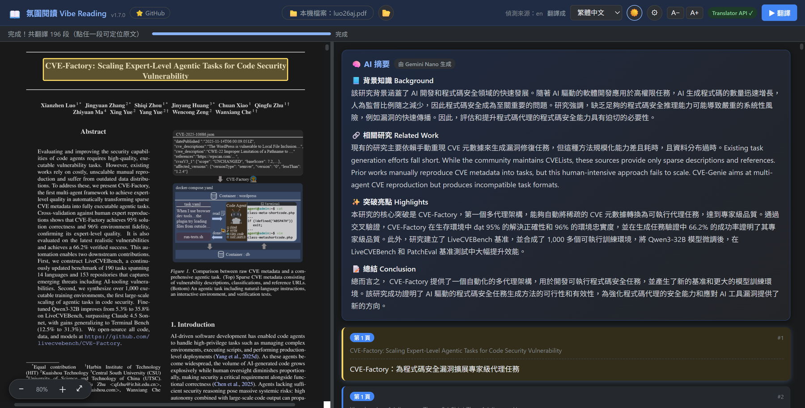

# 氛圍閱讀 Vibe Reading 📖

> 向「沉浸式翻譯」致敬 — 但**完全離線、零 API Key、零雲端費用**。
> 基於 Chrome／Edge 內建 AI（Translator API / Gemini Nano），在地端把整份 PDF 論文與**任意網頁**逐段翻成你的語言。

### 🚀 [立即安裝 — Chrome 線上應用程式商店](https://chromewebstore.google.com/detail/%E6%B0%9B%E5%9C%8D%E9%96%B1%E8%AE%80-vibe-reading/aaiiajcclefdjeegondambmholpnkjme)

### 🎬 Demo

> 🎥 [觀看完整高畫質影片（demo.mp4）](https://github.com/aaaddress1/vibe-reading/raw/main/demo.mp4)

---

## 這是什麼？

一個 Chrome／Edge 擴充功能。打開 PDF（例如 arxiv 論文）後，**自動**把全文逐段翻譯，並排顯示在右側；在**一般網頁**上則以行內雙語對照就地翻譯。所有 AI 推理都跑在你自己的電腦上 —— 內容**不會送到任何雲端**。

- 🔒 **完全離線**：用 Chrome 138+／Edge 148+ 內建的 Translator API 與 Gemini Nano，資料不離開瀏覽器
- 💸 **零成本**：沒有 OpenAI / Anthropic 帳單，沒有 rate limit
- 🌗 **暗黑主題**：護眼的雙欄閱讀介面

## ✨ 功能

- **逐段翻譯**：左側渲染原始論文、右側對照翻譯（併發加速）
- **雙向定位**：點翻譯 → 左側論文捲動並**高亮對應原文**；點原文 → 右側翻譯高亮
- **自動偵測來源語言**：你只需選「翻譯成」哪種語言（預設＝瀏覽器語言，可記憶設定）
- **自動翻譯**：開啟即翻，也可手動重翻
- **🧠 AI 摘要**：讀完整份論文後，頂部以 Gemini Nano 生成四大重點 —— 背景知識、相關研究、突破亮點、總結
- **🤖 反白問 AI**：在論文中反白文字，直接向 Gemini Nano 提問；提問會附上 AI 摘要與該段前後文作為上下文，回答更精準（可隨時停止、視窗不鎖住可邊讀邊問）
- **🌐 反白快速翻譯**：反白文字後點「翻譯」，面板立即顯示該段譯文——零輸入，輸入框保留供追問
- **🧭 首次安裝導覽**：安裝後依瀏覽器語系顯示繁中／英文設定頁，提示選擇預設目標語言，並引導開啟「允許存取檔案網址」以讀取本機 PDF
- **🩺 內建 AI 檢查（v1.5 新增）**：初次設定會檢查瀏覽器支援哪些 AI 功能，不能用時依 Chrome／Edge 一步步教你開啟
- **⚙️ 可重新開啟設定**：右上角齒輪可隨時重新選擇預設目標語言、檢查本機檔案權限
- **✏️ 字卡編輯模式**：雙擊任一段譯文就地編輯，可手動修改文字、按 Enter 重新分段；失焦或 Ctrl+Enter 儲存、Esc 取消
- **⌨️ Alt+T 熱鍵**：在任意 PDF 分頁按 Alt+T 一鍵開啟翻譯；也可點工具列圖示或右鍵選單
- **🎯 更忠實的 AI 翻譯（v1.5 新增）**：不摘要、不增刪，保留數字、單位、網址、公式與引用
- **🔍 PDF 獨立縮放**：Ctrl+滾輪／觸控板雙指只縮放左側 PDF（不連動整頁），平滑如原生；←/→ 翻頁
- **📰 雙欄論文支援**：自動偵測分欄，左右欄正確分開讀取
- **📐 版面分析分段**：以本機小模型（PP-DocLayout-S，CPU 執行、完全離線）辨識段落、標題與圖表，圖表裡的文字不再被當成段落；跨欄、跨頁斷開的段落會自動接回
- **🔤 翻譯字體調整**：A−／A+ 調整右側字體大小（記憶設定）
- **🌙 PDF 暗黑模式**：右上角一鍵把左側 PDF 切成深色底、淺色字，圖表保留原本色調（記憶設定）
- **🌐 網頁沈浸式翻譯**：每個網頁右下角**常駐一顆翻譯球**（可在設定頁關閉）
  - **點球＝整頁翻譯**：行內雙語對照，並自動跟隨無限捲動／SPA 新增的內容；再點一次切回原文
  - **預設懸停翻譯**：**按住修飾鍵（預設 Shift，可在設定頁更改）**移到段落即翻該段
  - **選取翻譯**：反白文字後按 **`Alt+S`**（v1.5 新增，可自訂）或右鍵「翻譯選取的文字」，只翻選取（浮卡顯示）
  - 滑鼠移到球上展開選單：切換語言、開關懸停、⚙ 設定、隱藏球
  - **隱藏翻譯球（v1.5 新增）**：按 ✕ 可選「只隱藏這次／這個網站不再顯示／所有網站都不顯示」；在網頁按右鍵 →「重新顯示翻譯球」或到設定頁即可改回
- **🧩 支援 Microsoft Edge 桌面版（v1.5 新增）**：Edge 148+ 可直接翻譯；AI 摘要／反白問答目前需 Edge Canary／Dev
- **📱 本機翻譯模型（v1.7 新增，Android 版 Edge 也能用）**：瀏覽器沒有內建 AI 時，自動改用 Opus-MT 翻譯模型，在本機 CPU 執行
  - 每個語言組合第一次使用時從 Hugging Face 下載約 110MB，之後存在瀏覽器裡、離線可用
  - 支援英文翻成繁中／簡中／法／德／西／俄／葡，以及其他語言翻成英文（非英文之間會經英文轉譯）；不支援翻成日文、韓文
  - 品質與速度不如內建 AI；AI 摘要／反白問答仍需 Gemini Nano
  - 桌面版也能試用：到設定頁把「翻譯引擎」改成「本機翻譯模型」
- **📂 開啟本機 PDF 檔案（v1.7 新增）**：檢視器上方 📂 按鈕可直接選檔或拖曳 PDF，不需要「允許存取檔案網址」（手機上就是用這個方式開 PDF）
- **🌗 暗黑主題、完全離線、零 API Key**

## 📦 安裝

> 💡 **安裝完成後會自動開啟「初次設定」**，檢查你的瀏覽器支援哪些 AI 功能（翻譯、AI 摘要／反白問答）。若有功能無法使用，會依你的瀏覽器（Chrome 或 Edge）一步步說明如何開啟，並提供「開啟 flags 設定」按鈕；設定好後按「重新檢查」即可。之後也可以隨時從檢視器右上角的 ⚙ 重新檢查。

**方法一（推薦）：Chrome 線上應用程式商店一鍵安裝**
👉 https://chromewebstore.google.com/detail/%E6%B0%9B%E5%9C%8D%E9%96%B1%E8%AE%80-vibe-reading/aaiiajcclefdjeegondambmholpnkjme

**方法二：手動載入開發版**（也可到 [Releases](https://github.com/aaaddress1/vibe-reading/releases) 下載打包 zip）

1. **載入擴充功能**：
   - 開啟 `chrome://extensions`
   - 右上角開啟「開發人員模式」
   - 點「載入未封裝項目」→ 選擇本資料夾（已內含 `lib/`，無需額外下載）

2. **啟用 Chrome 內建 AI（僅首次，兩種安裝方式都需要）**：
   - `chrome://flags` → 啟用 **Prompt API** 與 **Translator API** → 重啟 Chrome
   - `chrome://components` → 更新 **Optimization Guide On Device Model**（約 2.4GB）
   - 若要讀取本機 PDF，請到 `chrome://extensions` → 管理此擴充功能 → 開啟「允許存取檔案網址」

**Microsoft Edge（桌面版）**

- 安裝：Edge 可直接從上方 Chrome 線上應用程式商店安裝（首次會詢問是否「允許來自其他商店的擴充功能」），或到 `edge://extensions` 開啟「開發人員模式」→「載入解壓縮」
- 翻譯與語言偵測：Edge **148+** 內建 Translator / Language Detector API，免設定
- AI 摘要與反白問答：Edge 的 Prompt API 仍為開發者預覽，**目前只有 Edge Canary / Dev 提供**（正式版無法使用）。需到 `edge://flags` 啟用 **Prompt API for on-device language model** 後重啟，並到 `edge://on-device-internals` 確認 Device performance class 為 High 以上（約需 5.5GB VRAM）
- 本機 PDF：到 `edge://extensions` → 詳細資料 → 開啟「允許存取檔案 URL」

## 📁 本機 PDF 注意事項

Chrome 擴充功能預設**不能讀取 `file://` 本機檔案網址**。如果要翻譯電腦裡的 PDF，請手動開啟：

1. 到 `chrome://extensions`
2. 找到「氛圍閱讀 Vibe Reading」並點「詳細資料」或「管理擴充功能」
3. 將「允許存取檔案網址」設成開啟 / enable

若沒有開啟這個權限，線上 PDF 仍可使用，但本機 PDF 會無法載入。

## 🚀 使用

**翻譯 PDF：**

1. 打開任何 PDF（例如 `https://arxiv.org/pdf/2507.02092`）
2. 點工具列的擴充圖示，或在 PDF 頁面**右鍵 →「翻譯整份 PDF」**
3. 新分頁開啟雙欄檢視器，自動開始翻譯
4. 需要更改預設語言或檢查本機檔案權限時，點右上角齒輪
5. 點翻譯定位原文、反白文字問 AI、看頂部 AI 摘要

**翻譯一般網頁：**

1. 每個網頁右下角會有一顆翻譯球：**點球＝整頁翻譯**（再點切回原文）；也可用工具列圖示／`Alt+T`
2. **懸停翻譯（預設開）**：按住 `Shift`（可改）將滑鼠移到段落即翻該段
3. 滑鼠移到球上會展開選單：切換目標語言（與 PDF 共用）、開關懸停、⚙ 設定、隱藏球
   - 按 ✕ 可選擇「只隱藏這次」、「這個網站不再顯示」或「所有網站都不顯示」；之後想改回：在網頁按右鍵（或對工具列圖示按右鍵）→「氛圍閱讀：重新顯示翻譯球」，或到擴充功能設定頁的「不顯示懸浮球的網站」／「在網頁顯示懸浮球」
4. 只想翻一段：反白後**右鍵 →「翻譯選取的文字」**
5. 設定（修飾鍵、是否顯示球）：球選單的 ⚙，或 `chrome://extensions` →「詳細資料」→「擴充功能選項」

## ⌨️ 快捷鍵一覽

**全域快捷鍵**（可在 `chrome://extensions/shortcuts` 或 `edge://extensions/shortcuts` 更改）

| 按鍵 | 功能 |
|------|------|
| `Alt+T` | PDF 分頁：開啟雙欄翻譯檢視器；一般網頁：整頁翻譯／切回原文 |
| `Alt+S` | 翻譯網頁上反白的文字（浮卡顯示） |

**一般網頁**

| 操作 | 功能 |
|------|------|
| 點右下角 📖 翻譯球 | 整頁翻譯／切回原文 |
| 按住 `Shift` ＋ 滑鼠移到段落 | 懸停翻譯該段（修飾鍵可在設定頁改成 `Alt`／`Ctrl`／`⌘`） |
| `Esc` | 關閉選取翻譯浮卡 |

**PDF 檢視器**

| 按鍵／操作 | 功能 |
|------|------|
| `Ctrl` ＋ 滾輪、觸控板雙指 | 只縮放左側 PDF |
| `←` ／ `→` | 上一頁／下一頁 |
| `↑` ／ `↓` | 捲動 |
| `PageUp` ／ `PageDown` | 捲動一個畫面 |
| `Home` ／ `End` | 跳到第一頁／最後一頁 |
| 點右側譯文 | 左側 PDF 捲動並高亮對應原文 |
| 點左側原文 | 右側高亮對應譯文 |
| 反白原文 → 「翻譯」／「問 AI」 | 開啟問 AI 視窗：`Enter` 送出、`Shift+Enter` 換行、`Esc` 關閉 |
| 雙擊譯文 | 就地編輯：`Enter` 重新分段、`Ctrl+Enter` 或點別處儲存、`Esc` 取消 |
| 右上角 🌙 | PDF 暗黑模式開關 |
| 右上角 `A−`／`A+` | 調整譯文字體大小 |

## ⌨️ Alt+T 沒反應？

選取文字翻譯的預設快捷鍵為 `Alt+S`（一般網頁適用，不包含瀏覽器內建 PDF 閱讀器）。在網頁反白文字後按快捷鍵，即以浮卡顯示譯文。可到擴充功能設定中的「選取翻譯快捷鍵」查看目前按鍵，點「設定快捷鍵」變更或移除。Edge 可直接開啟 `edge://extensions/shortcuts`，Chrome 則為 `chrome://extensions/shortcuts`。若快捷鍵衝突未自動指派，請手動設定。

Chrome 的 `commands.suggested_key` 只是建議快捷鍵；如果 `Alt+T` 已被其他擴充功能、開發版、Chrome 或作業系統占用，Chrome 可能不會把它指派給商城版。

請到 `chrome://extensions/shortcuts` 檢查「氛圍閱讀 Vibe Reading」的快捷鍵：

1. 找到「用氛圍閱讀翻譯目前分頁的 PDF」
2. 確認它有被設成 `Alt+T`
3. 如果同時安裝了開發版與商城版，請停用其中一個，或替其中一個改用其他快捷鍵

## 🧩 技術

| 元件 | 用途 |
|------|------|
| **Translator API** | 地端專用翻譯模型（優先，快且省空間） |
| **Gemini Nano（Prompt API）** | 翻譯備援 + AI 摘要 + 反白問答 |
| **LanguageDetector API** | 自動偵測來源語言 |
| **PDF.js** | 渲染 PDF 與可選取文字層 |
| **PP-DocLayout-S（onnxruntime-web）** | 本機 CPU 版面分析（約 5MB 模型、每頁約 0.2 秒）：辨識內文、標題、圖說、圖、表、頁首頁尾，讓段落切得正確、圖表文字不混入翻譯 |
| **Content script 注入** | 一般網頁的沈浸式行內翻譯（共用上述同一引擎） |
| **Opus-MT（onnxruntime-web，背景 service worker）** | 沒有內建 AI 時的本機翻譯備援（每個語言組合約 110MB，首次下載） |

## ⚠️ 系統需求

- Chrome **138+**（Windows 10/11、macOS 13+、Linux、Chromebook Plus）
- **Translator / Language Detector API**：自 Chrome 138 起**正式穩定、免開 flag**
- **Gemini Nano（Prompt API）**（AI 摘要 / 反白問答 / 翻譯備援）需另外啟用，且硬體門檻較高：
  - `chrome://flags` 啟用 **Prompt API for Gemini Nano** → 重啟 → `chrome://components` 更新
    **Optimization Guide On Device Model**（或查 `chrome://on-device-internals` 確認狀態）
  - 需 **macOS 13+** / Windows 10+ / Linux、磁碟 **≥ 22GB 可用**、**GPU VRAM > 4GB**
    （或 Chrome **140+** 的 CPU 後援：16GB RAM + 4 核）、首次需不限流量網路下載模型（約 2–4GB）
  - Apple Silicon（M 系列）符合需求；較舊的 Intel Mac 可能需靠 CPU 後援
- 或 Microsoft Edge **148+**（桌面版；AI 摘要 / 反白問答目前僅 Edge Canary / Dev 可用，見〈安裝〉）
- **Android 版 Edge** 等沒有內建 AI 的 Chromium 瀏覽器：翻譯改用本機翻譯模型（見上方〈功能〉），AI 摘要／反白問答無法使用
  - Android 版 Chrome 不支援擴充功能；Android 版 Edge 需從 Edge 外掛程式商店安裝
- 不支援 iOS

## 🙏 致謝

感謝以下貢獻者讓這個專案變得更好：

- **[@hackerpeanutjohn](https://github.com/hackerpeanutjohn)**
  - [#3](https://github.com/aaaddress1/vibe-reading/pull/3) — **一般網頁沉浸式翻譯**：常駐翻譯球、整頁行內雙語對照、選取翻譯、修飾鍵懸停翻譯，並把翻譯引擎抽成 `translate-core.js`，讓 PDF 檢視器與一般網頁共用同一套實作
  - [#1](https://github.com/aaaddress1/vibe-reading/pull/1) — PDF 雙欄／區塊翻譯改進，以及 macOS 安裝支援
- **[@JackGrence](https://github.com/JackGrence)**
  - [#6](https://github.com/aaaddress1/vibe-reading/pull/6) — **選取文字翻譯快捷鍵**（預設 `Alt+S`），並在選項頁顯示／設定快捷鍵
- **[@pingqLIN](https://github.com/pingqLIN)**
  - [#4](https://github.com/aaaddress1/vibe-reading/pull/4) — 改進 Gemini Nano 翻譯提示詞：忠實翻譯、保留數字／公式／引用，並防止原文被當成指令
  - [#5](https://github.com/aaaddress1/vibe-reading/pull/5) — Prompt API 相容新版 Chrome 的 MTP speculative decoding，並強化 AI 摘要的格式驗證

也向啟發本專案的「沉浸式翻譯」致敬。

PDF 版面分析使用 PaddlePaddle 的 [PP-DocLayout-S](https://huggingface.co/PaddlePaddle/PP-DocLayout-S)（Apache-2.0）與 Microsoft 的 [onnxruntime-web](https://github.com/microsoft/onnxruntime)（MIT），授權條款見 `lib/layout/`、`lib/ort/`。

本機翻譯模型為赫爾辛基大學的 [Opus-MT](https://github.com/Helsinki-NLP/Opus-MT)（CC-BY 4.0；使用 [Xenova](https://huggingface.co/Xenova) 轉出的 ONNX 版本，執行時才下載、不隨套件散布），分詞使用 Hugging Face 的 [tokenizers.js](https://github.com/huggingface/tokenizers.js)（Apache-2.0），簡轉繁使用 [opencc-js](https://github.com/nk2028/opencc-js)（MIT；字典資料 Apache-2.0），授權條款見 `lib/tokenizers/`、`lib/opencc/`。

歡迎 issue 與 PR — [Issues](https://github.com/aaaddress1/vibe-reading/issues) 是個好的起點。

## 📄 授權

MIT License

---

# Vibe Reading 📖 (English)

> A tribute to "Immersive Translate" — but **fully offline, no API key, no cloud bills**.
> Translates entire PDF papers and any web page paragraph-by-paragraph using Chrome's / Edge's built-in on-device AI (Translator API / Gemini Nano).

## Features

- **Paragraph translation** with original paper on the left, translations on the right
- **Two-way locate**: click a translation → paper scrolls & highlights the source; click source → translation highlights
- **Auto source-language detection** — you only pick the *target* language (defaults to your browser language, remembered)
- **Auto-translate** on open, with manual re-run
- **🧠 AI Summary** by Gemini Nano: Background, Related Work, Highlights, Conclusion
- **🤖 Ask-AI on selection**: highlight text and ask Gemini Nano; the prompt includes the AI summary and the surrounding paragraphs as context. Stoppable, and the panel is non-blocking so you can keep reading
- **🌐 Quick-translate on selection**: hit "翻譯" on the floating bar and the panel instantly shows the translation — zero typing, with the input kept for follow-ups
- **🧭 First-run guide**: shows Traditional Chinese or English based on browser language, lets you choose the default target language, and guides you to enable file URL access for local PDFs
- **🩺 Built-in AI check (new in v1.5)**: the first-run page checks which AI features your browser supports and walks you through enabling them on Chrome or Edge
- **⚙️ Reopenable settings**: use the top-right gear anytime to update the default target language or check local file access
- **✏️ Editable translation cards**: double-click any translation to edit in place — fix wording or re-paragraph with Enter; blur/Ctrl+Enter saves, Esc cancels
- **⌨️ Alt+T hotkey** to open the translator on any PDF tab (also via toolbar icon or right-click menu)
- **🎯 More faithful AI translation (new in v1.5)**: no summarizing, adding or dropping content; numbers, units, URLs, formulas and citations are preserved
- **🔍 Independent PDF zoom**: Ctrl+wheel / trackpad pinch zooms only the left PDF (smooth, native-like); ←/→ flip pages
- **📰 Two-column papers** detected and read column-by-column
- **📐 Layout-aware paragraphs**: a small on-device layout model (PP-DocLayout-S, CPU, fully offline) finds paragraphs, headings, figures and tables, so text inside figures/tables stays out of the translation and paragraphs split across columns or pages are re-joined
- **🌙 PDF dark mode**: one click (top right) turns the PDF pane dark with light text while figures keep their colours (remembered)
- **🔤 Adjustable translation font** (A−/A+, remembered) · **🌗 dark theme · fully offline · no API key**
- **🌐 Immersive web-page translation**: a persistent translate ball sits on every page (can be disabled in options)
  - **Click the ball = translate the whole page** inline and bilingually, following infinite scroll / SPA updates; click again to restore the original
  - **Hover translate**: hold the modifier key (default `Shift`, configurable) and point at a paragraph to translate just that block
  - **Selection translate**: highlight text, then press **`Alt+S`** (new in v1.5, customizable) or right-click → "翻譯選取的文字" to translate only the selection in a popup card
  - Hover the ball to reveal its panel: target language (shared with the PDF viewer), hover toggle, ⚙ options, hide ball
  - The ✕ button lets you hide the ball just this once, on the current site, or on all sites; undo it anytime via right-click (on the page or the toolbar icon) → "氛圍閱讀：重新顯示翻譯球", or from the options page
- **🧩 Microsoft Edge desktop support (new in v1.5)**: translation works on Edge 148+; AI Summary / Ask AI currently need Edge Canary / Dev
- **📱 Local translation model (new in v1.7, works on Edge for Android)**: when the browser has no built-in AI, translation falls back to Opus-MT models running on the CPU
  - Each language pair downloads about 110MB from Hugging Face on first use, then stays in the browser and works offline
  - English → Traditional/Simplified Chinese, French, German, Spanish, Russian, Portuguese, and other languages → English (non-English pairs pivot through English); Japanese and Korean targets are not supported
  - Slower and lower quality than the built-in AI; AI Summary / Ask AI still need Gemini Nano
  - To try it on desktop, set "翻譯引擎" (translation engine) to "本機翻譯模型" (local model) in the options page
- **📂 Open a local PDF file (new in v1.7)**: the 📂 button in the viewer opens a file picker (or drop a PDF), no file-URL permission needed — this is how you open PDFs on a phone

## Install

> 💡 **A first-run setup page opens right after installation.** It checks which AI features your browser supports (translation, AI Summary / Ask AI). If something is unavailable, it walks you through enabling it for your browser (Chrome or Edge), with an "Open flags" button; click "Recheck" when you're done. You can rerun the check anytime from the ⚙ button in the viewer.

**Option 1 (recommended): [Install from the Chrome Web Store](https://chromewebstore.google.com/detail/%E6%B0%9B%E5%9C%8D%E9%96%B1%E8%AE%80-vibe-reading/aaiiajcclefdjeegondambmholpnkjme)** — one click.

**Option 2: load unpacked** (or grab a packaged zip from [Releases](https://github.com/aaaddress1/vibe-reading/releases)):

1. `chrome://extensions` → Developer mode → **Load unpacked** → select this folder (`lib/` is already bundled).
2. First run (needed for both options): enable **Prompt API** & **Translator API** in `chrome://flags`, restart, then update **Optimization Guide On Device Model** in `chrome://components` (~2.4GB).

**Microsoft Edge (desktop):** install from the Chrome Web Store link above (allow extensions from other stores when prompted) or load unpacked via `edge://extensions`. Translation and language detection work out of the box on Edge **148+**. AI Summary and Ask-AI use Edge's Prompt API, which is a developer preview available **only in Edge Canary / Dev** (not Stable): enable **Prompt API for on-device language model** in `edge://flags`, restart, and check that `edge://on-device-internals` reports a device performance class of High or above (~5.5GB VRAM).

## Local PDF Access

Chrome extensions cannot read `file://` local file URLs by default. To translate PDFs from your computer, enable this manually:

1. Go to `chrome://extensions`
2. Open details / manage extension for "氛圍閱讀 Vibe Reading"
3. Turn on **Allow access to file URLs**

Online PDFs still work without this permission, but local PDFs will fail to load until it is enabled.

## Keyboard Shortcuts

**Global** (change them at `chrome://extensions/shortcuts` or `edge://extensions/shortcuts`)

| Key | Action |
|-----|--------|
| `Alt+T` | PDF tab: open the side-by-side viewer; regular page: translate the page / restore the original |
| `Alt+S` | Translate the selected text on a web page (popup card) |

**Web pages**

| Input | Action |
|-------|--------|
| Click the 📖 ball (bottom right) | Translate the page / restore the original |
| Hold `Shift` + point at a paragraph | Hover-translate that paragraph (modifier can be `Alt` / `Ctrl` / `⌘` in options) |
| `Esc` | Close the selection-translation card |

**PDF viewer**

| Key / input | Action |
|-------------|--------|
| `Ctrl` + wheel, trackpad pinch | Zoom only the PDF pane |
| `←` / `→` | Previous / next page |
| `↑` / `↓` | Scroll |
| `PageUp` / `PageDown` | Scroll one screen |
| `Home` / `End` | Jump to the first / last page |
| Click a translation | Scroll the PDF to its source and highlight it |
| Click source text in the PDF | Highlight its translation |
| Select source text → "翻譯" / "問 AI" | Open the Ask-AI panel: `Enter` sends, `Shift+Enter` new line, `Esc` closes |
| Double-click a translation | Edit in place: `Enter` re-paragraphs, `Ctrl+Enter` or click away saves, `Esc` cancels |
| 🌙 (top right) | Toggle PDF dark mode |
| `A−` / `A+` (top right) | Translation font size |

## Alt+T Not Working?

**Translate selected text:** select text on a regular webpage and press `Alt+S` to show its translation in a floating card. This shortcut does not apply to the browser's built-in PDF viewer. In the extension options, **選取翻譯快捷鍵** (Selection shortcut) shows the current binding; click **設定快捷鍵** (Configure) to change or remove it. You can also open `edge://extensions/shortcuts` in Edge or `chrome://extensions/shortcuts` in Chrome and find **用氛圍閱讀翻譯選取的文字** under Vibe Reading. If the suggested shortcut conflicts with another binding, assign one manually. After updating an unpacked extension, reload it and refresh your webpage.

Chrome treats `commands.suggested_key` as a suggested shortcut. If `Alt+T` is already used by another extension, an unpacked development build, Chrome, or the operating system, Chrome may leave the Web Store build unassigned.

Open `chrome://extensions/shortcuts`, find Vibe Reading, and confirm that "用氛圍閱讀翻譯目前分頁的 PDF" is assigned to `Alt+T`. If both the unpacked build and the Web Store build are installed, disable one of them or assign different shortcuts.

## Requirements

- Chrome **138+** on Windows 10/11, macOS 13+, Linux, or Chromebook Plus
- Or Microsoft Edge **148+** (desktop; AI Summary / Ask-AI currently need Edge Canary / Dev, see Install)
- Edge for Android and other Chromium browsers without built-in AI: translation uses the local model (see Features); AI Summary / Ask-AI are unavailable. Chrome for Android does not support extensions; install from Edge Add-ons on Edge for Android.
- Not available on iOS.

## 🙏 Acknowledgements

Thanks to the contributors who made this project better:

- **[@hackerpeanutjohn](https://github.com/hackerpeanutjohn)**
  - [#3](https://github.com/aaaddress1/vibe-reading/pull/3) — **immersive translation for regular web pages**: the persistent translate ball, inline bilingual full-page mode, selection translate, modifier-hover translate, and extracting the shared engine into `translate-core.js` so the PDF viewer and web pages share one implementation
  - [#1](https://github.com/aaaddress1/vibe-reading/pull/1) — two-column / block translation improvements for PDFs, plus macOS setup support

And a tribute to "Immersive Translate" for the inspiration.

PDF layout analysis uses PaddlePaddle's [PP-DocLayout-S](https://huggingface.co/PaddlePaddle/PP-DocLayout-S) (Apache-2.0) and Microsoft's [onnxruntime-web](https://github.com/microsoft/onnxruntime) (MIT); see `lib/layout/` and `lib/ort/` for their licenses.

The local translation models are [Opus-MT](https://github.com/Helsinki-NLP/Opus-MT) by the University of Helsinki (CC-BY 4.0; ONNX exports by [Xenova](https://huggingface.co/Xenova), downloaded at runtime and not bundled). Tokenization uses Hugging Face's [tokenizers.js](https://github.com/huggingface/tokenizers.js) (Apache-2.0) and Simplified→Traditional conversion uses [opencc-js](https://github.com/nk2028/opencc-js) (MIT; dictionary data Apache-2.0); see `lib/tokenizers/` and `lib/opencc/`.

## License

MIT
